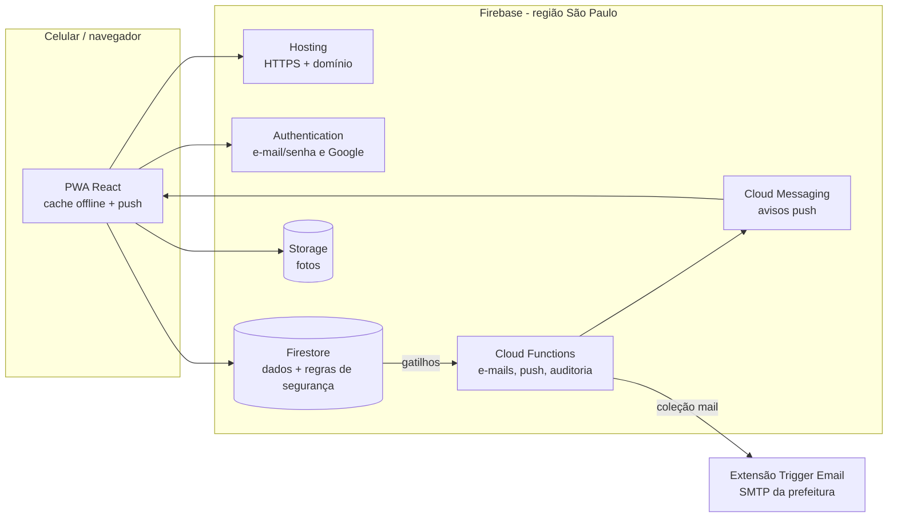

# Super App Rolim de Moura

Aplicativo da **Prefeitura Municipal de Rolim de Moura (RO)** para o cidadão registrar problemas da cidade (zeladoria), falar com a ouvidoria, encontrar farmácias de plantão e receber comunicados — e para a prefeitura atender tudo isso em um painel.

É um **PWA** (Progressive Web App): abre no navegador e se instala na tela inicial do celular **sem passar pela Play Store ou App Store**. Funciona sem internet para consulta e envia avisos (push) no Android, no computador e no iPhone (iOS 16.4+, com o app adicionado à Tela de Início).

> **Versão 2.** Substitui a versão 1 (Keycloak + FastAPI + PostgreSQL + MinIO + Traefik + Jenkins), que exigia servidores próprios e equipe especializada. Agora tudo roda em serviços gerenciados do **Firebase** (Google), sem servidor para instalar ou manter. Veja [docs/ARQUITETURA.md](docs/ARQUITETURA.md).

## O que o app faz

| Cidadão | Prefeitura (painel em `/painel`) |
| --- | --- |
| Zeladoria com mapa, GPS, endereço automático e foto | Visão geral com indicadores, mapa e ranking por bairro |
| Ouvidoria: elogio, sugestão ou reclamação sobre uma unidade | Filas de zeladoria e ouvidoria com resposta oficial e notas internas |
| Protocolo com linha do tempo e resposta da prefeitura | Comunicados enviados como aviso push para toda a cidade |
| Farmácias de plantão ordenadas pela distância | Cadastro de unidades públicas e farmácias |
| Avisos push e e-mail a cada mudança de situação | Equipe e acessos por perfil (Administrador, Servidor, Farmácia) |
| Funciona offline; exclusão de conta (LGPD) | Farmácias atualizam o próprio plantão |
| Confirmação de e-mail para receber avisos por e-mail | Acesso de equipe só para e-mails confirmados |

## Arquitetura em uma imagem



## Estrutura do repositório

```
web/              PWA (Vite + React + Mantine) — app do cidadão e painel
  src/domain/     regras de negócio puras (status, protocolo, CPF, geografia) + testes
  src/data/       acesso ao Firestore/Storage (substitui as rotas da API antiga)
  src/pages/      telas do cidadão e do painel (admin/)
  e2e/            testes de ponta a ponta (Playwright)
functions/        Cloud Functions: e-mails, push, comunicados, auditoria, LGPD
firestore.rules   quem pode ler/escrever o quê (substitui o backend de permissões)
storage.rules     acesso às fotos
tests/rules/      testes automatizados das regras de segurança
scripts/          dados de demonstração e criação do primeiro administrador
docs/             implantação, arquitetura, operação e migração
```

## Rodar no seu computador

Pré-requisitos: Node.js 22+, Java 21+ (para os emuladores) e Firebase CLI (`npm i -g firebase-tools`).

```bash
npm run setup
```

```bash
npm run emulators
```

Em outro terminal, crie os dados de demonstração e abra o app:

```bash
npm run seed
```

```bash
npm run dev
```

- App: http://localhost:5180 — painel: http://localhost:5180/painel
- Console dos emuladores: http://localhost:4100
- Contas de teste (somente no emulador): `cidadao@rolim.test`, `servidor@rolim.test`, `admin@rolim.test`, `farmacia@rolim.test` — a senha está em [`scripts/seed-emulator.mjs`](scripts/seed-emulator.mjs).

Nada disso toca dados reais: o projeto `demo-rolim` existe apenas na sua máquina.

## Testes

```bash
npm test
```

```bash
npm run test:e2e
```

| Suíte | O que cobre |
| --- | --- |
| `web` (Vitest) | status, protocolo, CPF/telefone, limite do município, indicadores, endereço |
| `functions` (Vitest) | conteúdo e segurança dos e-mails |
| `test:rules` | 39 cenários de permissão e de ataque: cidadão, servidor por unidade, farmácia, admin, fotos |
| `test:e2e` (Playwright) | PWA instalável, service worker, abertura offline, login, escopos, bloqueios e atendimento completo |

## Publicar

Siga [docs/IMPLANTACAO.md](docs/IMPLANTACAO.md). Em resumo: criar o projeto no Firebase, preencher `web/.env.production`, e rodar `firebase deploy`. Depois disso, cada atualização é um clique em **Actions → Publicar no Firebase**.

## Documentação

- [Implantação passo a passo](docs/IMPLANTACAO.md)
- [Arquitetura e decisões](docs/ARQUITETURA.md)
- [Operação do dia a dia](docs/OPERACAO.md)
- [Migração do sistema antigo](docs/MIGRACAO.md)
