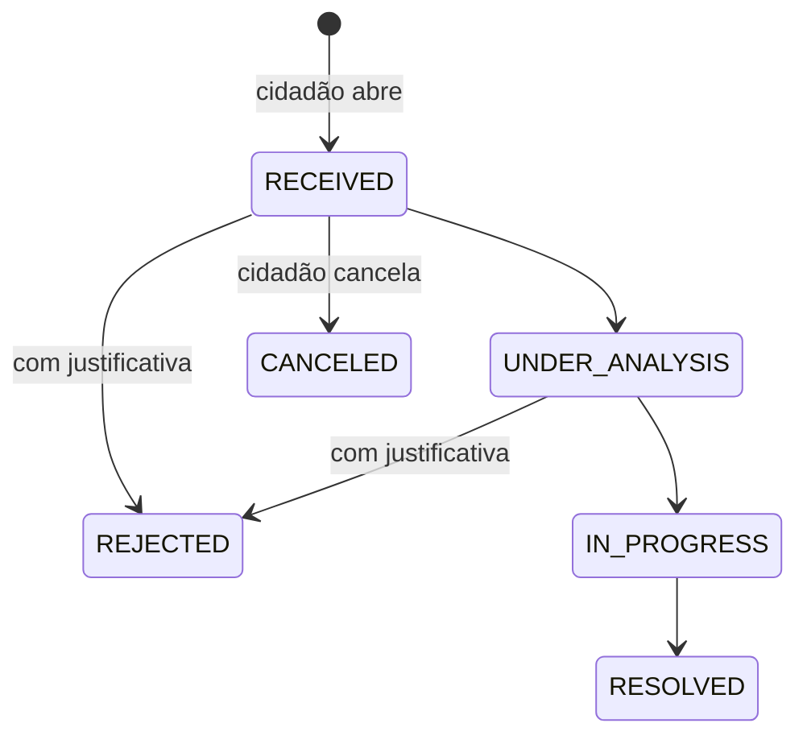

# Arquitetura e decisões

## Por que mudar

A versão 1 funcionava, mas dependia de uma equipe para manter **oito serviços** em servidores próprios:

| Versão 1 (auto-hospedada) | Papel | Versão 2 (gerenciada) |
| --- | --- | --- |
| Keycloak + PostgreSQL + tema + validador de CPF em Java | Contas e login | Firebase Authentication + cadastro em `users/` |
| API FastAPI (Python) + Alembic | Regras de negócio e permissões | `firestore.rules` + Cloud Functions |
| PostgreSQL | Dados | Cloud Firestore |
| MinIO (bucket público) | Fotos | Cloud Storage (fotos privadas) |
| Traefik + certificados | HTTPS e domínio | Firebase Hosting (HTTPS automático) |
| Jenkins | Publicação | GitHub Actions + `firebase deploy` |
| Mailer próprio | E-mails | Extensão oficial *Trigger Email* |
| Loki + Grafana + Alloy | Logs | Cloud Logging (já incluso) |
| App das lojas + painel Next.js separado | Interface | Um único PWA (cidadão + painel) |

Resultado: **nenhum servidor para instalar, atualizar ou proteger** via RDP/Linux. Backups, escalonamento, certificados e atualizações de segurança ficam com o Google. Veja abaixo [onde cada dado fica](#onde-os-dados-ficam).

## Componentes

- **PWA (`web/`)** — React 19 + Vite + Mantine. Uma só base de código para o cidadão e o painel; telas carregadas sob demanda. O *service worker* (`web/src/sw.ts`) guarda o app para uso offline e recebe os avisos push. O Firestore usa cache persistente: protocolos ficam disponíveis sem internet e solicitações sem foto são enviadas quando a conexão volta.
- **Regras (`firestore.rules`, `storage.rules`)** — são o "backend" de autorização. Validam quem escreve, quais campos, formatos (CPF, protocolo, datas), se o local está dentro do município e o fluxo de status. Têm 40 testes automatizados, incluindo tentativas de ataque.
- **Cloud Functions (`functions/`)** — reagem a mudanças no banco: e-mail ao abrir e a cada mudança de status, aviso push ao cidadão, envio de comunicados para todos, auditoria de equipe/unidades e limpeza de dados ao excluir conta.

## Modelo de dados (Firestore)

| Coleção | Conteúdo | Quem lê / escreve |
| --- | --- | --- |
| `users/{uid}` | nome, CPF, celular, e-mail, e-mail confirmado | a própria pessoa; equipe abre um cadastro por vez (sem listar a base) |
| `cpfs/{cpf}` | `{ uid }` — garante 1 CPF por conta | criado no cadastro; equipe consulta um CPF por vez |
| `staff/{uid}` | perfis (`ROOT`, `CIVIL_SERVANT`, `DUTY_MANAGER` = responsável por plantão), unidades, ativo | somente admin; só ativa contas com e-mail confirmado |
| `buildings/{id}` | unidades públicas (`PUBLIC`), farmácias (`PHARMACY`) e funerárias (`FUNERAL`), local, telefones, aberta/plantão | público lê; admin edita; responsável por plantão altera só aberta/plantão das que gerencia |
| `issues/{id}` | zeladoria: categoria, local, endereço, foto, status, protocolo `ZEL-AAAA-XXXXXXXX` | autor e equipe |
| `issues/{id}/history/{status}` | cada mudança de status com resposta oficial | autor e equipe; equipe cria |
| `issues/{id}/notes/{id}` | observações internas | só equipe |
| `ombudsman/{id}` (+ `history`, `notes`) | ouvidoria sobre uma unidade pública, protocolo `OUV-…` | autor e equipe **da unidade** |
| `notifications/{id}` | comunicados (rascunho → fila → enviado) | enviados são públicos; equipe da unidade gerencia |
| `devices/{token}` | aparelhos para push | o próprio usuário |
| `mail`, `audit` | fila de e-mails e trilha de auditoria | só Cloud Functions (admin lê `audit`) |

### Fluxo de atendimento

Cada mudança feita pela equipe grava, no mesmo lote, o documento `history/{novoStatus}`; as regras recusam a mudança sem esse registro. Assim o histórico nunca fica incompleto.

## Onde os dados ficam

| Dado | Serviço | Local |
| --- | --- | --- |
| Cadastro (nome, CPF, celular), solicitações, histórico, notas, unidades, equipe, comunicados | Cloud Firestore | Brasil — `southamerica-east1` (São Paulo) |
| Processamento (e-mails, avisos, auditoria) | Cloud Functions | Brasil — `southamerica-east1` |
| Fotos anexadas à zeladoria | Cloud Storage, bucket `superapp-rolim.firebasestorage.app` | **EUA — `us-east1`** (escolha da prefeitura: cabe nos 5 GB gratuitos do Storage) |
| Conta de acesso (e-mail, senha protegida) | Firebase Authentication | Infraestrutura global do Google (EUA) |
| Envio de avisos push | Firebase Cloud Messaging | Infraestrutura global do Google |
| Arquivos do app | Firebase Hosting (CDN) | Global, servido do ponto mais próximo |

A transferência internacional (fotos, contas e avisos) segue o art. 33 da LGPD, com o Google como operador sob as cláusulas de proteção de dados do contrato do Google Cloud. A página **Privacidade** do app informa isso ao cidadão. Recomenda-se que o encarregado de dados (DPO) da prefeitura registre essa transferência no inventário de dados.

O local do bucket padrão não pode ser alterado. Se no futuro a prefeitura quiser as fotos no Brasil, crie um bucket adicional em `southamerica-east1`, aponte `VITE_FIREBASE_STORAGE_BUCKET` e o alvo de regras do Storage para ele e copie as fotos existentes.

## Decisões e limites conhecidos

- **Firebase em vez de servidor próprio:** a prioridade é operar sem equipe técnica dedicada. O backend antigo já usava Firebase para push, então a conta Google também já era uma dependência.
- **Um único app:** o painel antigo (Next.js) exigia servidor Node. Agora o painel é uma área do mesmo PWA, protegida por perfil — um deploy só.
- **Status unificado:** zeladoria e ouvidoria usam o mesmo fluxo (antes eram dois conjuntos de nomes). Foram adicionados *Indeferida* (com justificativa obrigatória) e *Cancelada*.
- **Ouvidoria:** ganhou os assuntos *Elogio* e *Sugestão*.
- **Mapas:** OpenStreetMap (gratuito) em vez de Google Maps (pago). O endereço é sugerido pelo serviço Nominatim; como o OpenStreetMap não tem os bairros de Rolim de Moura, o bairro é digitado — preencha `NEIGHBORHOODS` em `web/src/config/city.ts` para oferecer sugestões padronizadas.
- **Limite do município:** polígono oficial do IBGE (código 1100288) em `web/src/config/city.ts`; as regras conferem o retângulo envolvente.
- **E-mail confirmado:** o cadastro guarda se o e-mail foi confirmado (conferido contra o token do login). Acesso de equipe e e-mails automáticos só valem para endereços confirmados — evita que alguém registre o e-mail de um futuro servidor ou use o e-mail de terceiros.
- **Autoria:** histórico, notas e comunicados levam o nome oficial do cadastro de equipe, conferido nas regras; um comunicado só pode sair em nome da unidade que o servidor atende.
- **Privacidade no aparelho:** ao sair ou excluir a conta, o cache local do app é apagado (computadores e celulares compartilhados).
- **CPF:** validado pelos dígitos verificadores e único por conta. Como no sistema antigo, o cadastro é autodeclarado; se alguém registrar um CPF que não é seu, o administrador apaga `cpfs/{cpf}` pelo console.
- **Google e e-mail na mesma conta:** quem tem conta por e-mail e senha liga o Google no Perfil (`linkWithPopup`). Se esse Google já entrou no app sozinho, `auth/takenGoogleAccount.ts` confere a outra conta numa instância paralela do Firebase (só na memória) e, se ela não tem cadastro nem acesso de equipe, apaga essa entrada vazia e liga o Google à conta com CPF. A regra de CPF único não muda.
- **iPhone:** avisos push exigem iOS 16.4+ e o app adicionado à Tela de Início (o app mostra as instruções).
- **Firebase JS SDK fixado em 12.14.0:** a partir da 12.15 o Firestore inclui a biblioteca `re2js` (+59 KB gzip no carregamento inicial) sem benefício para este app. Ao atualizar, compare o tamanho do build e confira `prepareGoogleSignIn` em `web/src/lib/firebase.ts`, que usa uma API interna do Auth (`_getInstance`).
- **Abertura em rede lenta:** a abertura verde do `index.html` aparece sem esperar CSS nem JavaScript (o CSS do app é pré-carregado e aplicado pelo `main.tsx` antes de montar o React). A Início pinta antes do Firebase: o login (`auth/authRuntime.ts`) e os dados da Início (`data/lazy.ts`) carregam o SDK logo depois da primeira pintura. O Auth é criado com `initializeAuth` sem o resolvedor de popup, que no celular baixava o iframe do Google (~95 KB) na abertura; o login com Google recebe o resolvedor na hora e prepara o iframe quando o botão aparece.
- **Tamanho:** ~292 KB gzip de JavaScript na primeira visita, dos quais ~160 KB antes da primeira tela (o `npm run build` mostra a divisão); depois o app abre do cache do aparelho.

## Custos

Estimativa para o porte de Rolim de Moura (~55 mil habitantes), com milhares de solicitações por ano: a maior parte do uso cabe nas cotas gratuitas do plano Blaze (Firestore, Functions, Hosting, Authentication e Cloud Messaging). As fotos ficam no bucket dos EUA, dentro da cota gratuita de 5 GB do Storage (as fotos são comprimidas para ~300 KB, então cabem cerca de 15 mil). **Espere de R$ 0 a algumas dezenas de reais por mês**; configure o alerta de orçamento para ter certeza. Preços mudam: confira https://firebase.google.com/pricing.
